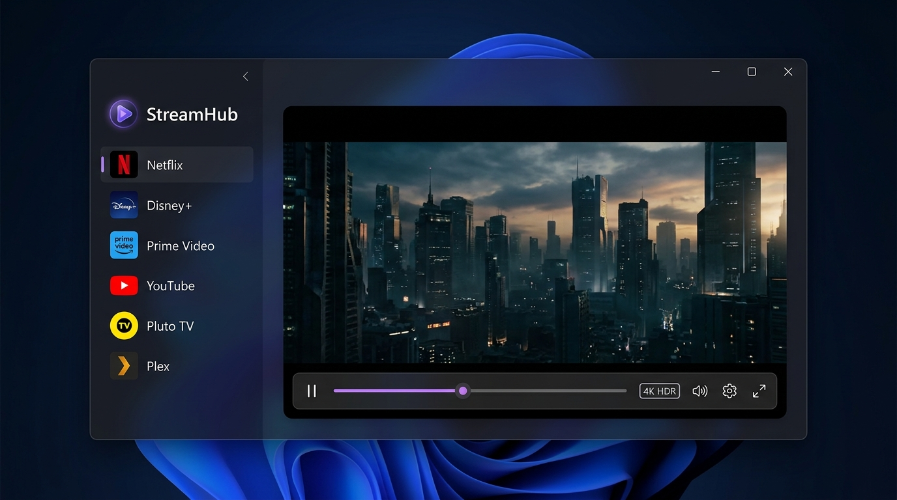

# 🎬 StreamHub — Centre de Téléchargement & Mises à Jour Officielles

Bienvenue sur le dépôt de distribution officiel de **StreamHub** pour Windows 11.

---

### 📦 Télécharger la dernière version

👉 **[Télécharger StreamHub-Setup.exe (Dernière version)](https://github.com/SharkLog76/streamhub-releases/releases/latest)**

---

### 🌟 Aperçu de StreamHub

| Vue Principale (Fluent Design 2) | Mode Split-Screen (Double flux) |
| :---: | :---: |
|  |  |

| Palette de Commandes (Ctrl+K) |
| :---: |
|  |

---

### ⚡ Fonctionnalités
- **Agrégateur SVOD Complet** : Netflix, Disney+, Prime Video, YouTube, Pluto TV, Molotov, Plex + sources custom.
- **DRM Matériel 1080p/4K** : Accélération matérielle PlayReady SL3000 et Widevine L1.
- **Auto-Skip & AdBlock Natifs** : Détection automatique des génériques et filtrage des publicités.
- **Multi-tâche Intelligent** : Picture-in-Picture Always-on-Top et Split-Screen avec bascule audio au survol.
- **Mises à Jour Silencieuses Velopack** : Téléchargement transparent en tâche de fond et notification Toast Windows 11.

---

### ℹ️ Informations Légales
Ce produit est sous licence propriétaire fermée. Tous droits réservés &copy; 2026 StreamHub.
