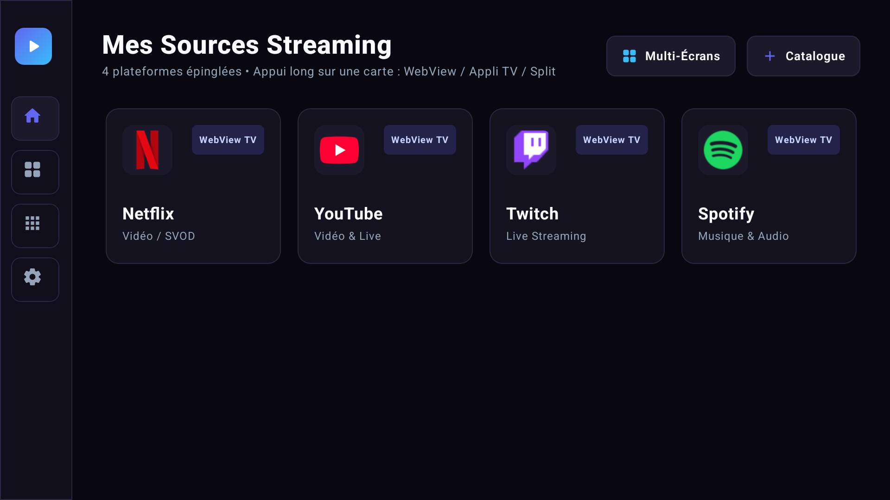
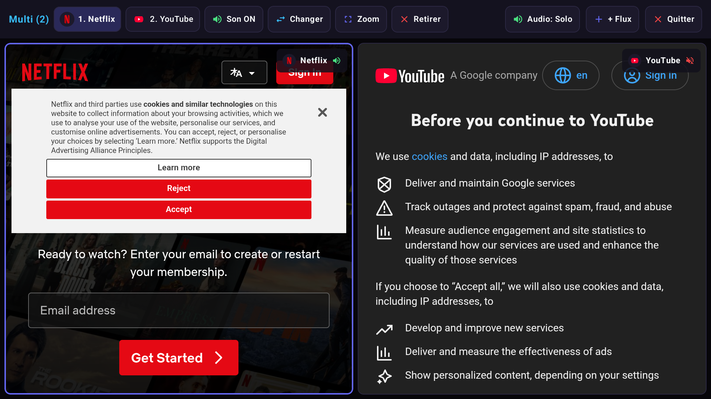

# 🎬 StreamHub — Centre de Téléchargement Officiel (Windows 11 & Android TV)

Bienvenue sur le dépôt de distribution public de **StreamHub** pour **Windows 11 (x64)** et **Android TV / Google TV**.

🌐 **[Découvrir la page de présentation interactive](https://sharklog76.github.io/StreamHub/)**

---

### 📦 Télécharger la dernière version (`v1.2.3`)

👉 **[Télécharger StreamHub v1.2.3 (Dernière version)](https://github.com/SharkLog76/streamhub-releases/releases/latest)**

- **Windows 11 — `StreamHub-win-Setup.exe`** *(Recommandé)* : Installeur complet avec icônes Windows et mises à jour automatiques silencieuses Velopack.
- **Windows 11 — `StreamHub-win-Portable.zip`** : Archive portable autonome prête à l'emploi sans installation.
- **Android TV / Google TV — `StreamHub-AndroidTV.apk`** : Application TV native pilotable à la télécommande (D-Pad), mode Hybride WebView TV + Applis natives, Multi-Écrans et PiP TV.

---

### 🌟 Aperçu de l'Application (Windows 11 & Android TV)

| Interface Windows 11 (Fluent Design 2) | Multi-Split-Screen Windows 11 |
| :---: | :---: |
|  |  |

| Accueil Android TV (D-Pad 1080p) | Multi-Écrans Android TV |
| :---: | :---: |
|  |  |

| Palette de Commandes (`Ctrl+K`) |
| :---: |
|  |

---

### ⚡ Points Forts de la v1.2.3

- **13 Plateformes avec Vraies Icônes & Comptes Personnalisés** : Netflix, YouTube, Twitch, Spotify, Deezer, Disney+, Prime Video, Crunchyroll, Apple TV+, Canal+, Pluto TV, Molotov TV, Plex — avec leurs logos officiels, un bandeau latéral filtré sur vos services activés et l'ajout de comptes custom.
- **Picture-in-Picture (PiP) Redimensionnable & Déplaçable** : Fenêtre flottante Always-on-Top sans barre de titre native, redimensionnable librement par tous les bords et via les boutons **`-` / `+`**, déplaçable à la souris, avec mémorisation de la taille.
- **Multi-Split-Screen Illimité** : Affichez 2, 3, 4+ flux simultanément en grille dynamique avec choix **« Conserver le son de tous »**, **« Solo au survol »** ou contrôle audio par tuile.
- **Plein Écran sans Bordure (`F11`) & Zone de Notification** : Profitez d'une immersion vidéo totale ou gardez Spotify/Deezer actifs dans la zone de notification Windows 11 lors de la fermeture.
- **DRM Matériel 1080p/4K, Auto-Skip & AdBlock** : PlayReady SL3000 / Widevine L1, saut automatique des génériques et filtrage réseau ciblé des publicités.
- **Mises à Jour Silencieuses Velopack** : Téléchargement transparent en arrière-plan et notification Toast Windows 11.

---

### ⌨️ Raccourcis Essentiels

| Raccourci | Action |
| :--- | :--- |
| `Ctrl + K` | Palette de commandes rapide |
| `Alt + P` | Picture-in-Picture (PiP) |
| `Ctrl + S` | Multi-Split-Screen |
| `F11` | Plein écran sans bordure |
| `Ctrl + M` | Couper / Rétablir le son |
| `Ctrl + Tab` | Passer au flux suivant |

---

### ℹ️ Informations Légales
Ce produit est sous licence propriétaire fermée. Tous droits réservés &copy; 2026 StreamHub.
